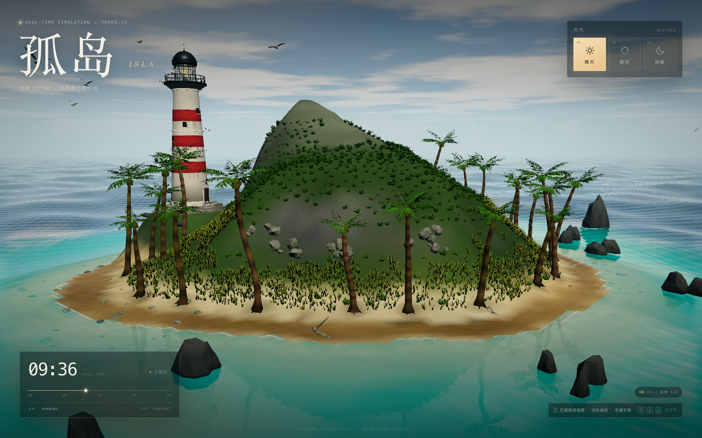
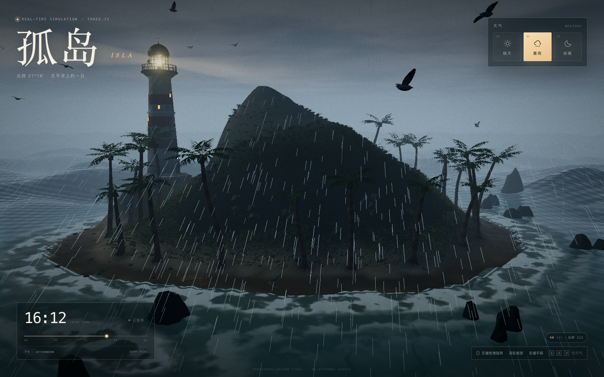
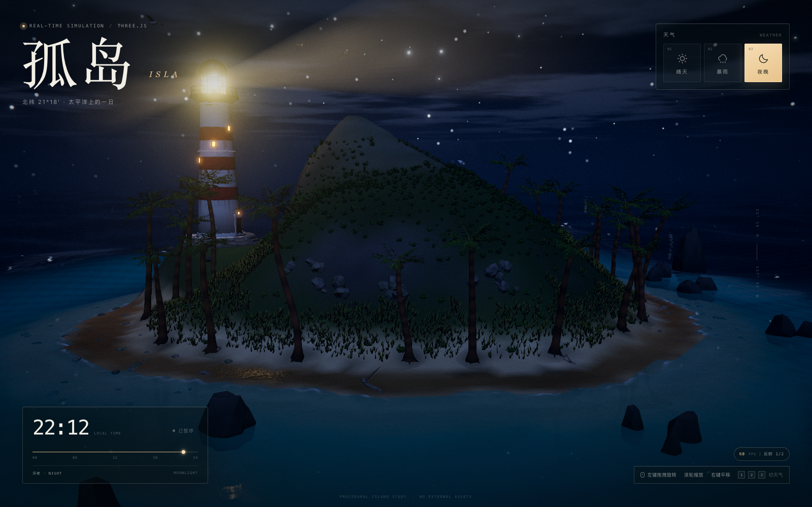
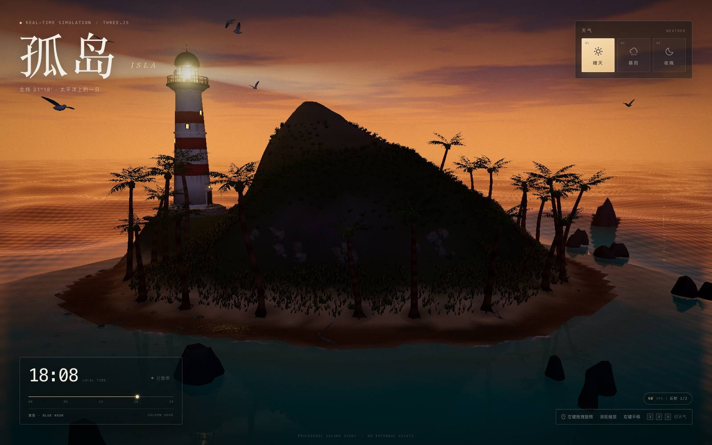

# 孤岛 · ISLA

一个完全程序化、无外部贴图的实时海岛 Three.js 场景。单文件地形高度场驱动整座岛，六层 Gerstner 海浪与半分辨率平面反射构成海面，灯塔、棕榈、草地、礁石、海鸟与动态天气共同组成一幅可交互的太平洋小岛。



## 运行

```bash
npm install
npm run dev          # http://127.0.0.1:5173
# 或
npm run build && npm run preview
```

要求 Node 20.19+（本项目在 Node 22 + Vite 8 上验证）。

## 操作

- **左键拖拽** 旋转，**滚轮** 缩放，**右键拖拽** 平移
- **1 / 2 / 3** 或右上按钮切换 晴天 / 暴雨 / 夜晚
- 左下时间滑块 **0–24 时**，点击「自动流转」让时间缓慢前进
- 支持窗口自适应与触屏单指旋转 / 双指缩放平移

## 场景能力

| 模块 | 实现 |
| --- | --- |
| `src/heightfield.js` | 唯一的 `heightAt(x,z)` 程序化高度场，同时生成地形网格、512² 海底深度纹理与所有植被/道具落点。海岸、水线、深度完全对齐。 |
| `src/water.js` | 六层 Gerstner 波 + 解析切/副切线法线；浅滩按烘焙深度自动压浪；半分辨率镜像相机 + 斜近裁剪平面反射；Fresnel、GGX 太阳高光、浪峰次表面透光、岸边碎浪与离岸泡沫线。 |
| `src/island.js` | 320² 顶点色地形：水下沙床 / 湿沙 / 干沙 / 草甸 / 岩石 / AO，逐顶点粗糙度与湿沙反天光 shader；礁石与断崖碎岩实例化。 |
| `src/vegetation.js` | 沿曲线放样的弯曲棕榈树干、逐片生成的羽叶与椰果；分层顶点着色器风摆；恰好 13,000 丛 GPU 风吹草；上千丛山坡灌木与野花。 |
| `src/structures.js` | 程序化 CanvasTexture 红白条纹灯塔、灯笼室、旋转体积光柱、灯室点光；23 块岸礁/海蚀柱、浮木、椰子、13 只海鸟。 |
| `src/sky.js` + `src/weather.js` | 自定义大气渐变、太阳/月亮、星空与银河、FBM 云层；三态天气平滑过渡；14,000 条 GPU 雨线、闪电与雷暴照明；浪高、风、雾浓度联动。 |
| `src/postfx.js` | ACES + Bloom + 线性调色 + SMAA + 暗角 / 颗粒 / 径向色散；帧率低于 38 时自动逐级降低像素比与反射分辨率。 |

## 结构

```
index.html            HUD、天气/时间控件、入场动画
src/main.js           渲染器、相机、逐帧编排、自适应画质、键盘/指针交互
src/postfx.js         HDR 后处理链
src/environment.js    共享 time / weather / env 状态
src/heightfield.js    地形与海底高度场（唯一数据源）
src/island.js         地形、顶点色、湿沙 shader、碎岩
src/water.js          Gerstner 海面与平面反射
src/vegetation.js     棕榈、草、灌木、野花
src/structures.js     灯塔、光柱、礁石、浮木、椰子、海鸟
src/sky.js            天空、星月、云、光照
src/weather.js        天气过渡、雨、闪电、雾
```

## 技术备注

- 实时阴影贴图在当前 WebGL2/ANGLE-Metal + HDR composer 组合下会与后处理采样器发生冲突，因此场景 intentionally 使用烘焙地形 AO、湿沙反光和棕榈接触阴影来保持接地感；这牺牲了动态投影，但换来了稳定、跨平台一致的 HDR 输出和 60 fps。
- 所有内容均在运行时程序化生成，无网络请求、无外部图片/模型。
- 控制台调试接口：`window.ISLA` 提供 `setTime()`、`setWeather()`、`setQuality()`、`setCamera()`、`snapshot()` 等方法。

## 预览

| 晴天 | 暴雨 |
| --- | --- |
|  |  |
| **夜晚** | **日落** |
|  |  |
